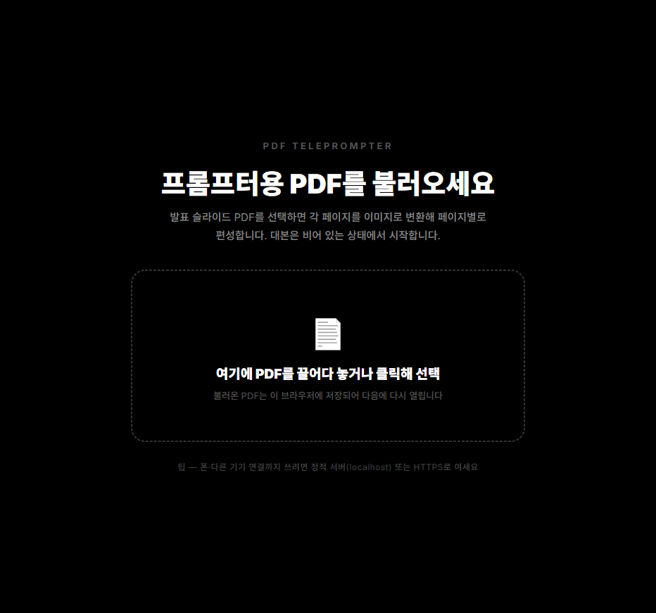
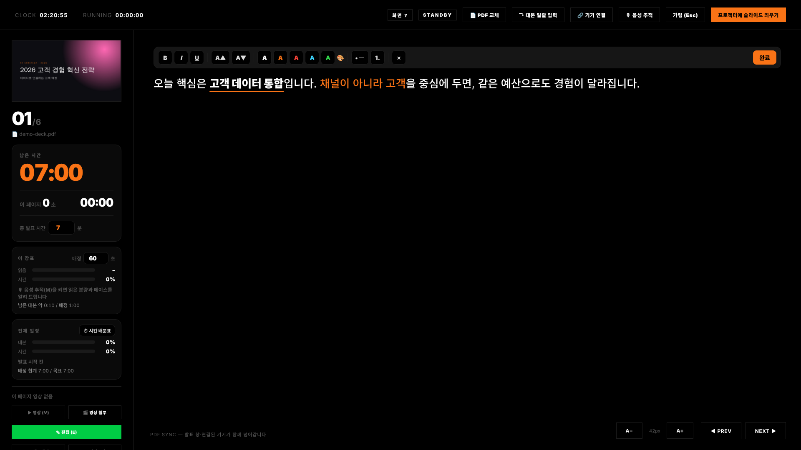
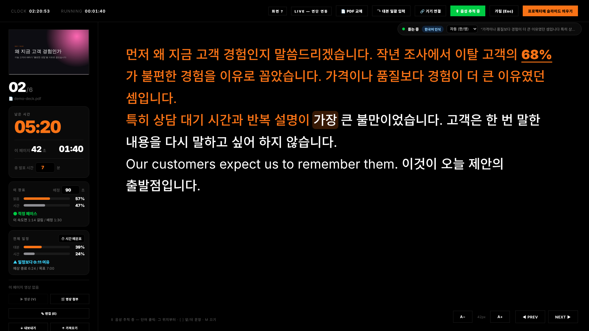
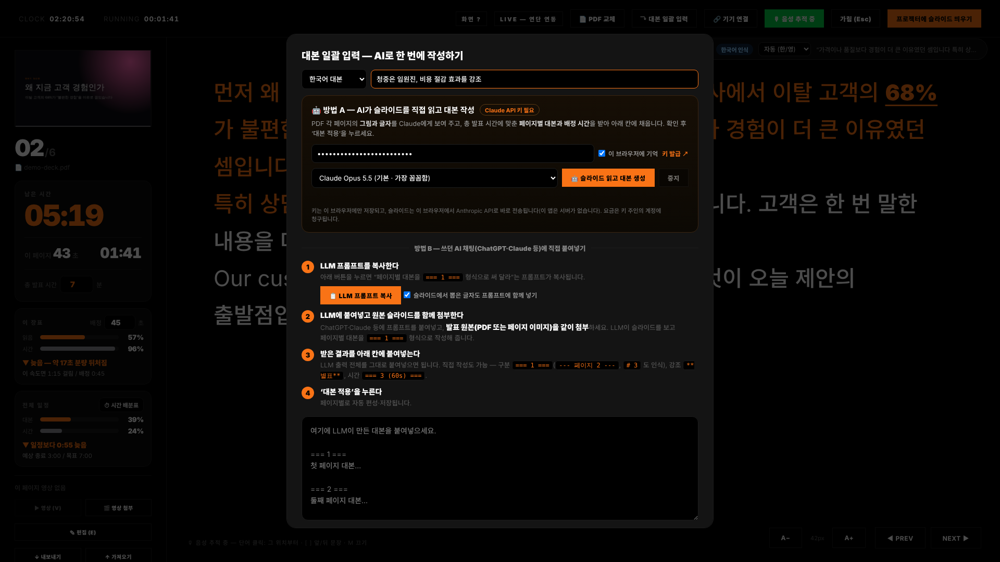
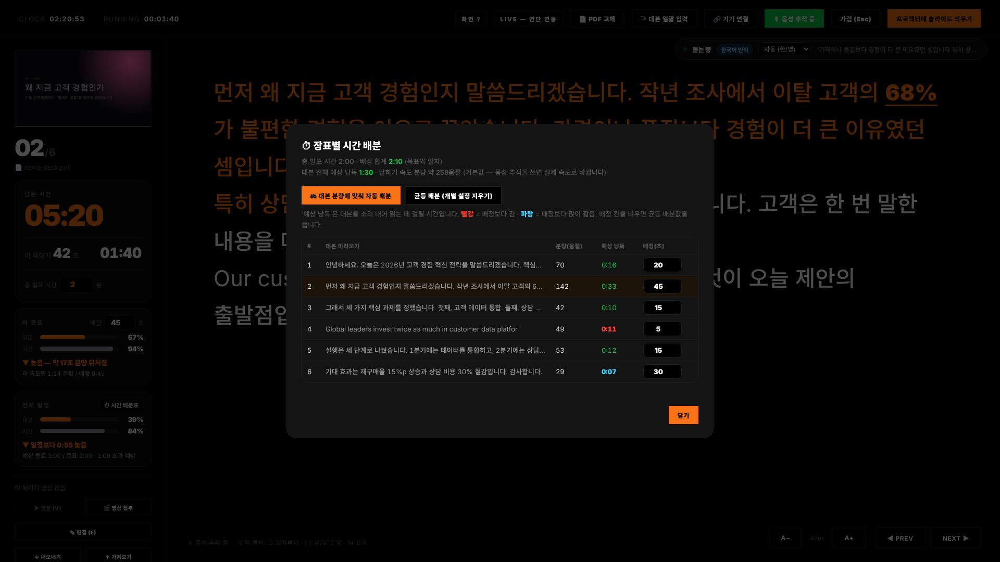
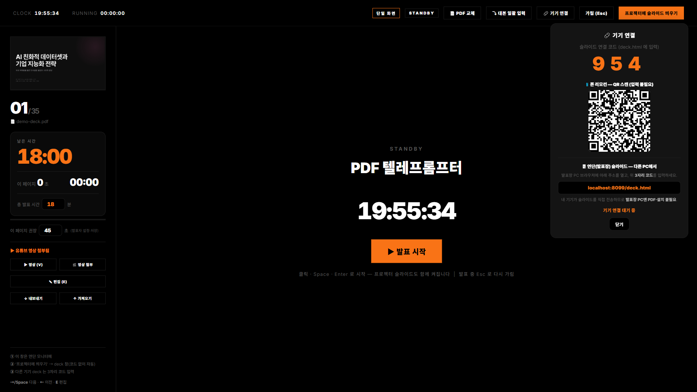
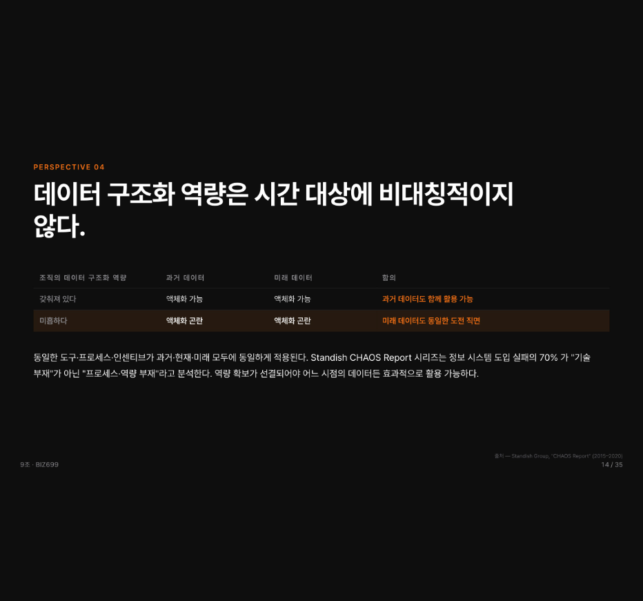

# 🎤 PDF 텔레프롬프터

**발표 PDF 하나만 넣으면, 발표에 필요한 세 가지가 한 번에 준비됩니다.**
발표자 노트북에는 **대본과 타이머**, 프로젝터에는 **슬라이드**, 손에는 **휴대폰 리모컨** — 따로 맞출 필요 없이 자동으로 연결됩니다.

### 🔗 바로 사용하기 (설치 필요 없음)

| 어디서 여나 | 주소 | 무엇이 뜨나 |
|---|---|---|
| 🧑‍💻 **내 기기** (노트북·아이패드 — 조종석) | **https://bizsinsightclub.github.io/prompter/** | 대본·타이머·리모컨 (발표자용) |
| 🖥 **발표장 PC** (빔프로젝터 연결 — 큰 화면) | **https://bizsinsightclub.github.io/prompter/deck.html** | 슬라이드만 (관객용) |

> 내 노트북을 빔프로젝터에 **직접(HDMI) 연결**한다면 위쪽 주소 하나만 열고 ‘프로젝터에 슬라이드 띄우기’를 누르면 됩니다. 발표장 PC가 따로 있을 때만 아래 `deck.html` 주소를 그 PC에서 엽니다. (자세히는 [👇 핵심 차별점](#-내-기기로-발표하고-발표장-화면을-원격으로-조종하기-핵심-차별점))
>
> 팀원들이 **각자 API 키 없이** AI 대본 생성을 쓰게 하려면 같은 저장소를 **Vercel**에도 배포하세요 → [👇 Vercel로 배포하기](#-vercel로-배포하기--팀원은-키-없이-팀-암호로)

---

## 왜 만들었나요?

발표를 하다 보면 늘 이런 번거로움이 있습니다.

- 슬라이드는 프로젝터에 띄워야 하는데, **대본과 남은 시간**은 어디에 띄우지?
- 발표자료는 이미 **PDF로 완성**돼 있는데, 거기에 대본·타이머·리모컨을 따로 붙이기가 어렵다.
- 발표장(학교·회사) 와이파이에서 화면 공유나 연결이 잘 안 꼬인다.

이 앱은 **PDF 한 장만 올리면** 이 모든 걸 알아서 묶어줍니다. **설치도, 회원가입도, 서버도 필요 없습니다.** 인터넷 브라우저(크롬·엣지)만 있으면 됩니다.

## 무엇이 특별한가요?

| | 설명 |
|---|---|
| 🎯 **내 기기로 발표, 발표장 PC는 화면만** | 발표장 컴퓨터에 **내 파일을 옮기거나 프로그램을 설치할 필요가 없습니다.** 발표장 PC에서는 인터넷 주소 하나만 열고 **3자리 숫자**를 입력하면, 내 노트북·아이패드가 그 큰 화면을 **원격으로** 넘깁니다. (자세히는 아래 [👇 핵심](#-내-기기로-발표하고-발표장-화면을-원격으로-조종하기-핵심-차별점)) |
| 📄 **어떤 발표든 OK** | 슬라이드를 PDF로 내보내 올리기만 하면 됩니다. 특정 발표 내용이 앱에 박혀 있지 않아, 매번 새 발표에 재사용할 수 있습니다. |
| 🤖 **AI가 슬라이드를 읽고 대본 작성** | **Claude · ChatGPT · Gemini** 중 원하는 AI와 **모델 · 생각 깊이**를 골라 버튼 한 번이면, AI가 PDF 각 페이지의 **그림과 글자를 직접 보고** 발표용 대본과 **장표별 배정 시간**까지 써 줍니다. 키가 없으면 명령문을 복사해 쓰던 AI 채팅에 붙여넣는 방식도 그대로 쓸 수 있습니다. |
| 🎙 **음성 추적 — 가라오케처럼** | 마이크로 내 목소리를 듣고, 대본에서 **어디까지 읽었는지 실시간으로 색칠**합니다. 틀려서 다시 읽으면 하이라이트도 그 자리로 **되돌아가고**, 몇 문장 **건너뛰면 따라 넘어갑니다**. 한국어·영어 구간에 맞춰 **인식 언어가 자동 전환**됩니다. |
| ⏱ **페이스 코치** | 장표마다 **배정 시간**과 **읽은 분량(%)**을 비교해 “적정 · 늦음 · 빠름”을 알려 주고, 전체 일정 대비 몇 초 늦었는지·예상 종료 시각까지 보여 줍니다. |
| 🖥 **연단 컴퓨터에 파일을 안 보내도 됨** | 발표자 노트북이 현재 슬라이드 **그림을 직접 쏴 주기** 때문에, 프로젝터를 연결한 다른 컴퓨터에 PDF를 옮길 필요가 없습니다. |
| 🔢 **와이파이에서도 안전한 연결** | 복잡한 설정 대신 화면에 뜬 **3자리 숫자**만 입력하면 연결됩니다. |
| ⏱ **시간 관리 & 영상** | 총 발표 시간과 페이지별 권장 시간을 정해두고, 특정 페이지에 **유튜브·동영상**(mp4)을 끼워 넣을 수 있습니다. |

---

## 1분 만에 시작하기

1. **발표자 노트북**에서 위 링크를 엽니다.
2. **발표 PDF를 끌어다 놓고**, 총 발표 시간(분)을 입력합니다.
3. (선택) 대본을 직접 쓰거나, 오른쪽 위 ‘**준비**’ 메뉴의 ‘**대본 일괄 입력**’에서 **AI가 슬라이드를 읽고** 한 번에 쓰게 합니다.
4. 오른쪽 위 ‘**프로젝터에 슬라이드 띄우기**’를 누릅니다 → 큰 화면엔 슬라이드, 노트북엔 대본·타이머가 뜹니다.
5. (선택) ‘**🎙 음성 추적**’(또는 `M` 키)을 켜면, 말하는 대로 대본이 색칠되고 페이스를 알려 줍니다.
6. 휴대폰으로 넘기고 싶다면 ‘준비’ 메뉴의 ‘**기기 연결**’ QR을 스캔하세요.

> 💡 휴대폰·다른 기기 연결까지 쓰려면 위 **https 주소(GitHub Pages)** 로 여는 것이 가장 안정적입니다.

---

## 🎯 내 기기로 발표하고, 발표장 화면을 “원격으로” 조종하기 (핵심 차별점)

발표장에 가면 보통 **연단에 있는 남의 컴퓨터**가 빔프로젝터에 연결돼 있습니다. 보통은 USB로 파일을 옮기고, 그 컴퓨터의 키보드로 슬라이드를 넘기죠. 대본은 따로 종이로 들고요.

이 앱은 다르게 합니다. 기기를 **두 가지 역할**로 나눕니다.

| 기기 | 역할 | 무엇을 여나 |
|---|---|---|
| **① 내 기기** (노트북·아이패드·휴대폰) | **조종석** — 대본·타이머를 보고 슬라이드를 넘김 | `…/prompter.html` (그냥 첫 주소) |
| **② 발표장 PC** (빔프로젝터 연결) | **큰 화면** — 슬라이드만 표시 | `…/deck.html` |

### 연결 순서 (숫자만 입력하면 끝)

1. **내 기기**에서 앱을 열고 PDF를 올린 뒤, 오른쪽 위 **‘준비’ 메뉴 → ‘기기 연결’**을 누릅니다 → 화면에 **3자리 숫자**가 크게 뜹니다. (예: `699`)
2. **발표장 PC의 브라우저** 주소창에 아래 주소를 칩니다:

   ```
   bizsinsightclub.github.io/prompter/deck.html
   ```
3. 그 페이지에 **내 기기에 뜬 3자리 숫자**를 입력하고 연결을 누릅니다.
4. 끝났습니다. 이제 **내 기기에서 슬라이드를 넘기면 발표장 큰 화면도 같이 넘어갑니다.** 대본·타이머는 내 손 안의 기기에만 보입니다.

### 왜 좋은가요?
- **내 파일을 남의 컴퓨터에 넣지 않습니다.** 슬라이드는 내 기기가 그림으로 전송하므로, 발표장 PC에는 USB도 설치도 필요 없습니다.
- **내 자리에서 편하게.** 연단 키보드 앞에 서 있을 필요 없이, 내 노트북·아이패드를 들고 어디서든 넘깁니다.
- **숫자 3자리뿐.** 발표장·학교 와이파이에서도 복잡한 화면공유 설정 없이 연결됩니다. 매번 다른 숫자라 옆 강의실과 섞이지도 않습니다.

> 발표장 PC가 **카메라가 없어** QR을 못 찍어도 괜찮습니다 — 주소를 치고 숫자만 넣으면 됩니다.
> 내 노트북 한 대를 빔프로젝터에 직접(HDMI) 연결한 경우라면, 이 과정도 필요 없이 **‘프로젝터에 슬라이드 띄우기’** 버튼 하나면 됩니다.

---

## 화면 살펴보기

### 1) 시작 화면 — PDF 또는 HTML 덱 넣기
PDF를 끌어다 놓으면 각 페이지가 슬라이드로 만들어집니다. 여기서 **총 발표 시간**도 정합니다. (한 번 올린 슬라이드는 이 브라우저에 저장되어 다음에 자동으로 다시 열립니다.)
모션이 있는 **HTML 덱**은 `.html` 파일을 놓거나 덱 주소를 넣으면 됩니다 — [HTML 덱으로 발표하기](#html-덱으로-발표하기-모션-그대로) 참고.



### 2) 발표자 화면 — 대본·타이머·리모컨이 한곳에
발표 중 발표자만 보는 화면입니다.
- **왼쪽:** 현재 슬라이드 미리보기 · 파일 이름 · 큰 **남은 시간** 타이머(총 발표 시간 설정 포함) · **이 장표**(배정 시간·읽은 분량·페이스) · **전체 일정**.
- **오른쪽:** 대본. **워드처럼** 굵게·기울임·밑줄·글자 크기·**글자색**·목록을 지정할 수 있습니다.
- **위쪽 바:** 발표 중에 쓰는 **음성 추적 · 가림 · 프로젝터에 띄우기**만 늘 보이고, 발표 전에 쓰는 PDF 교체 · 대본 일괄 입력 · 기기 연결 · 대본 편집 · 영상 첨부 · 내보내기/가져오기 · 단축키 안내는 **‘준비’ 메뉴**에 모여 있습니다.
- **아래쪽 바:** 글자 크기(가− / 가+) · 이전 / 다음. 이 장표에 영상을 붙였으면 ‘▶ 영상 재생’ 버튼도 여기에 나타납니다.



### 3) 음성 추적 — 읽은 곳까지 가라오케처럼 색칠
‘**🎙 음성 추적**’을 켜고 말하면, 읽은 부분은 **주황색**으로 채워지고 다음에 읽을 단어에 **표시**가 붙습니다. 화면도 읽는 위치를 따라 자동으로 내려갑니다.
- 오른쪽 위 막대: 듣는 중 상태 · 지금 인식 언어(**한국어 / EN**) · 언어 모드(자동·고정) · 방금 들린 말.
- 왼쪽 **이 장표** 카드: 읽음 57% vs 시간 47% → “● 적정 페이스”. **전체 일정** 카드: 일정 대비 몇 초 여유/늦음 · 예상 종료 시각.



### 4) 대본을 AI로 한 번에 만들기
‘대본 일괄 입력’ 창에서 두 가지 방법 중 고르세요. 결과는 아래 칸에 채워지고, ‘대본 적용’을 누르면 페이지별로 자동으로 나뉘어 들어갑니다(배정 시간 포함).
- **방법 A — AI가 슬라이드를 직접 읽기:** **AI(Claude·ChatGPT·Gemini) → 모델 → 생각 깊이**를 고르고, 그 회사의 API 키(또는 팀 서버 암호)를 넣은 뒤 ‘슬라이드 읽고 대본 생성’. 각 페이지의 **이미지와 글자**를 함께 보여 주고, 총 발표 시간에 맞춘 대본·배정 시간을 받아 옵니다.
- **방법 B — 쓰던 AI 채팅에 붙여넣기:** ① 프롬프트 복사(슬라이드에서 뽑은 글자도 함께) → ② AI에 붙여넣고 슬라이드 첨부 → ③ 결과 붙여넣기 → ④ 적용.



### 5) 장표별 시간 배분표
‘전체 일정’ 카드의 **⏱ 시간 배분표**에서 장표마다 배정 시간을 한눈에 보고 고칩니다. ‘**대본 분량에 맞춰 자동 배분**’을 누르면 대본이 긴 장표에 시간을 더 줍니다. ‘예상 낭독’은 대본을 소리 내어 읽는 데 걸릴 시간으로, 배정보다 길면 **빨강**, 많이 짧으면 **파랑**으로 표시됩니다.



### 6) 기기 연결 — 휴대폰 & 프로젝터
‘기기 연결’을 누르면 **3자리 숫자**와 **QR 코드**가 나옵니다. 휴대폰은 QR만 찍으면 바로 연결되고, 다른 컴퓨터를 연단 화면으로 쓰려면 그 컴퓨터에서 화면을 열고 3자리 숫자를 입력합니다.



### 7) 연단 슬라이드 (프로젝터 화면)
프로젝터에 띄우는 전체 화면입니다. 발표자가 페이지를 넘기면 함께 넘어갑니다.



---

## 기능 자세히 보기

### 대본 쓰기
- **직접 편집** — ‘준비’ 메뉴의 ‘대본 편집’ 또는 `E` 키로 편집. 워드처럼 서식을 줄 수 있고, 입력하면 자동 저장됩니다.
- **AI로 한 번에** — 위 ‘대본 일괄 입력’ 참고. (직접 쓸 때는 페이지를 `=== 1 ===` 으로 구분, 강조는 `**별표**`, 배정 시간은 `=== 1 (40s) ===`)
- **백업/옮기기** — ‘준비’ 메뉴의 ‘대본 내보내기’로 파일(JSON) 저장, ‘대본 가져오기’로 다른 컴퓨터·브라우저에 복원.

### AI 대본 생성 (방법 A) 자세히
**고를 수 있는 AI · 모델 · 생각 깊이** (2026년 10월 기준 각 사 공식 문서)

| AI | 모델 (기본값은 굵게) | 생각 깊이 |
|---|---|---|
| **Claude** (Anthropic) | **Opus 5.5**(꼼꼼함) · Fable 5.1(최고 성능·비쌈) · Sonnet 5.5(빠르고 저렴) · Haiku 5.5(가장 저렴) | 낮음 · **보통** · 높음 · 매우 높음 · 최대 |
| **ChatGPT** (OpenAI) | **GPT-6.1 Sol**(균형) · GPT-6 Astra(최고 성능·비쌈) · GPT-6 Luna(가장 저렴·빠름) | 낮음 · **보통** · 높음 · 매우 높음 · 최대 (Luna는 ‘없음’도) |
| **Gemini** (Google) | **Gemini 3.8 Flash**(빠름) · Gemini 4 Argon(최고 성능) · Gemini 3.5 Flash-Lite(가장 저렴) | 낮음 · **보통** · 높음 (Flash-Lite는 ‘최소’가 기본) |

- **생각 깊이:** 높을수록 슬라이드를 더 꼼꼼히 따져 보고 쓰지만, **느리고 비싸집니다.** 대부분은 ‘보통’이면 충분합니다.
- **필요한 것(직접 호출):** 고른 회사의 API 키 — [Anthropic](https://console.anthropic.com/settings/keys) · [OpenAI](https://platform.openai.com/api-keys) · [Google AI Studio](https://aistudio.google.com/apikey)에서 발급. 키는 회사별로 따로 기억합니다. 요금은 키 주인의 계정에 청구됩니다.
- **팀 서버(Vercel 배포 시):** 서버에 키가 있는 AI는 목록에 ‘· 팀 서버’가 붙고, 키 대신 **팀 암호**만 넣으면 됩니다. 아래 [Vercel로 배포하기](#-vercel로-배포하기--팀원은-키-없이-팀-암호로) 참고.
- **선택 기억:** 마지막에 고른 AI·모델·생각 깊이는 다음에 열 때 그대로 남아 있습니다.
- **무엇을 보내나:** 페이지마다 이미지(JPEG)와 PDF에서 뽑은 글자, 총 발표 시간, 대본 언어(한국어/English), ‘추가 요청’ 문구. 요청 크기 한도를 넘으면 이미지를 자동으로 줄여 보냅니다.
- **보안:** 직접 호출은 키가 이 브라우저에만 저장되고(‘기억’ 체크 해제 시 저장 안 함), 슬라이드는 브라우저에서 고른 회사의 API로 **직접** 전송됩니다.
- AI는 소리 내어 읽을 문장만 쓰도록 안내받습니다([클릭] 같은 무대 지시 없음) — 음성 추적과 잘 맞도록.

### 🚀 Vercel로 배포하기 — 팀원은 키 없이 팀 암호로
GitHub Pages 버전은 그대로 두고, **같은 저장소를 Vercel에도 올리면** API 키를 서버에 넣어 둘 수 있습니다. 팀원은 Vercel 주소를 열고 **팀 암호**만 입력하면 됩니다(키는 브라우저로 내려가지 않습니다).

1. [vercel.com](https://vercel.com)에 GitHub 계정으로 가입 → **Add New… → Project** → `bizsinsightclub/prompter` 저장소 **Import**.
2. 설정 화면은 그대로 두고(Framework Preset: Other, Build Command 비움) **Deploy**.
3. 프로젝트 **Settings → Environment Variables**에 추가합니다.
   | 이름 | 값 | |
   |---|---|---|
   | `APP_PASSCODE` | 팀 암호(아무 문자열) | **필수** — 없으면 서버 키 방식이 꺼집니다(주소만 알면 누구나 쓰는 것 방지) |
   | `ANTHROPIC_API_KEY` | Claude 키 | 쓸 것만 |
   | `OPENAI_API_KEY` | ChatGPT 키 | 쓸 것만 |
   | `GEMINI_API_KEY` | Gemini 키 | 쓸 것만 |
4. **Deployments → 맨 위 배포 ⋯ → Redeploy** (환경 변수는 다시 배포해야 적용됩니다).
5. `https://<프로젝트이름>.vercel.app/` 주소와 팀 암호를 팀원에게 알려 주세요.

알아 둘 점
- 서버 키로 쓴 요금은 **키 주인**에게 청구됩니다. 팀 암호는 가끔 바꾸고(바꾼 뒤 Redeploy), 각 회사 콘솔에서 **사용 한도**를 걸어 두는 것을 권합니다.
- Vercel 서버 함수는 **요청 4.5MB** 한도가 있어, 서버 경유 시 슬라이드 이미지를 자동으로 더 작게 줄여 보냅니다(직접 호출보다 화질이 조금 낮을 수 있음).
- 무료(Hobby) 플랜은 한 번 생성이 **최대 5분**입니다. 장수가 많은 덱에 생각 깊이 ‘최대’는 5분을 넘길 수 있으니 ‘보통’을 권합니다. 무료 플랜은 개인·비상업용이라 **회사 업무용이면 Pro 플랜**이 필요할 수 있습니다(Vercel 약관 확인).
- 서버 키가 없는 AI는 Vercel에서도 지금처럼 **내 키로 직접** 호출할 수 있습니다. 음성 추적·기기 연결 등 나머지 기능은 두 주소에서 똑같이 동작합니다.

### 음성 추적 (가라오케 하이라이트)
- **켜기/끄기:** 위쪽 ‘🎙 음성 추적’ 버튼 또는 `M` 키. 처음 한 번 마이크 사용을 허용해야 합니다.
- **틀려서 다시 읽기:** 앞부분을 다시 말하면 하이라이트가 **그 자리로 되돌아가** 다시 시작합니다.
- **건너뛰기:** 몇 문장 건너뛰고 읽으면 하이라이트가 **그곳으로 넘어갑니다.** (자주 나오는 문구에 속지 않도록, 연달아 같은 곳을 가리킬 때만 이동합니다 — 1초 안팎)
- **애드리브:** 대본에 없는 말을 해도 하이라이트가 엉뚱하게 앞서가지 않고 기다립니다.
- **한/영 자동 전환:** 다음에 읽을 부분이 영어 문장이면 영어 인식으로, 다시 한국어가 나오면 한국어 인식으로 자동으로 바꿉니다. 한국어 문장 속 영어 단어 몇 개는 한국어 인식으로 그대로 따라갑니다. 막대의 선택칸에서 ‘한국어 고정 / English 고정’도 할 수 있습니다.
- **직접 맞추기:** 음성 추적 중 **단어를 클릭**하면 그 단어부터 다시 따라가고, `[` / `]` 로 앞/뒤 문장으로 옮깁니다.
- **지원 브라우저:** Chrome · Edge · Safari (Firefox는 음성 인식 미지원). Chrome·Edge의 음성 인식은 **인터넷 연결이 필요**합니다.

### 시간 관리 · 페이스
- **총 발표 시간** — 시작 화면이나 타이머 아래에서 분 단위로 설정. 큰 글씨로 **남은 시간**이 카운트다운됩니다.
- **장표별 배정 시간** — ‘이 장표’ 카드의 배정 칸 또는 **⏱ 시간 배분표**에서 정합니다. 대본 분량에 맞춘 자동 배분도 가능합니다.
- **이 장표 페이스** — 읽은 분량(%)과 배정 시간 경과(%)를 비교해 **● 적정 / ▼ 늦음 / ▲ 빠름 / ⏰ 초과 / ✓ 다 읽음**을 알려 주고, “이 속도면 1:13 걸림 / 배정 1:30”처럼 예상 소요 시간을 보여 줍니다. (읽은 분량은 음성 추적을 켰을 때 계산됩니다)
- **전체 일정** — 지금까지의 계획(장표별 배정 합) 대비 **몇 초 늦었는지/여유 있는지**와 **예상 종료 시각**을 보여 줍니다. 휴대폰 리모컨에도 읽은 분량과 페이스가 표시됩니다.
- **말하기 속도** — 음성 추적을 쓰면 내 실제 말하기 속도를 재서 남은 시간 예측에 반영합니다(기본값 분당 약 258음절).

### 페이지에 영상 넣기
‘준비’ 메뉴의 ‘이 페이지에 영상 첨부’로 **유튜브 링크**나 **내 동영상**(mp4)을 페이지에 붙입니다. 발표 중 **`V` 키**(또는 ▶ 영상 버튼·리모컨)를 누르면 슬라이드 위에 영상이 전체 화면으로 재생되고, 닫으면 슬라이드로 돌아옵니다.
- 유튜브는 어느 기기에서나 재생됩니다.
- 내 mp4는 **발표자 노트북과 같은 컴퓨터**의 프로젝터 화면에서 재생됩니다(다른 컴퓨터에서는 유튜브를 권장).

### HTML 덱으로 발표하기 (모션 그대로)
PDF로 바꾸면 사라지는 모션·애니메이션을 살리고 싶을 때, 덱 HTML 페이지를 그대로 띄웁니다.
- **여는 법** — 시작 화면에 `.html` 파일을 놓거나, 덱 주소(예: `https://bizsinsightclub.github.io/tesladeck1019/`)를 넣고 ‘HTML 덱 열기’. 덱에 적힌 발표자 노트가 있으면 대본으로 가져옵니다.
- **넘기기** — 프롬프터의 다음(→·버튼·폰 리모컨)이 덱 키를 대신 누릅니다. 남은 모션이 있으면 모션부터, 끝나면 다음 장. 덱 화면에서 직접 넘겨도 프롬프터가 따라옵니다.
- **발표장 화면** — ‘프로젝터에 띄우기’는 덱 페이지를 띄우고(그 창에서 `F` = 발표 모드), 다른 PC의 `deck.html`도 같은 덱을 주소로 열어 모션까지 따라 합니다.
- **조건** — 프롬프터와 **같은 사이트**(`bizsinsightclub.github.io/…`)에 올린 덱이어야 조종할 수 있습니다. 파일로 불러온 덱은 같은 PC에서만 됩니다. 덱 규칙: `section.slide`(현재 장 `.on`) · `data-note` · `go(n)` — web-slide-deck 템플릿이면 그대로 맞습니다.
- **준비된 발표** — `prompter.html?preset=tesla1019` 는 테슬라 덱 PDF와 정리된 대본으로, `&src=html` 을 붙이면 HTML 덱으로 엽니다. 덱의 ‘발표자 노트’ 버튼이 이 주소를 엽니다.

### 화면 연결 — 상황별로
- **내 노트북 1대를 빔프로젝터에 직접 연결(HDMI 등)** — ‘프로젝터에 슬라이드 띄우기’ 버튼만 누르면 됩니다. 숫자 입력도, 인터넷도 필요 없습니다.
- **발표장의 다른 PC가 빔프로젝터에 연결돼 있을 때** — 그 PC에서 **`…/deck.html`** 주소를 열고, 내 기기에 뜬 **3자리 숫자**를 입력합니다. (위 [핵심 차별점](#-내-기기로-발표하고-발표장-화면을-원격으로-조종하기-핵심-차별점) 참고)
- **휴대폰 리모컨** — ‘기기 연결’ QR을 스캔. 이전/다음·가림·영상 버튼과 함께, 휴대폰에서도 남은 시간과 대본을 볼 수 있습니다. (블루투스 리모컨의 페이지 넘김 버튼도 동작)

---

## 단축키 (발표자 화면)
`→ / Space` 다음 · `←` 이전 · `+/−` 글자 크기 · `E` 대본 편집 · `V` 영상 재생/닫기 · `M` 음성 추적 켜기/끄기 · `[` / `]` 앞/뒤 문장으로(음성 추적 중) · `Esc` 영상 닫기·화면 가림 · `Home/End` 처음/끝 · 대본 영역 **왼쪽/오른쪽 클릭**으로 이전/다음(음성 추적 중에는 **단어 클릭** = 그 위치부터).

## 잘 안 될 때
- 휴대폰·다른 기기가 연결되지 않으면, **세 기기를 같은 와이파이(또는 휴대폰 핫스팟)** 에 두세요. 가장 확실합니다.
- 노트북 1대로 프로젝터를 쓰는 경우는 **인터넷 연결이 필요 없습니다.** (단, 음성 추적과 AI 대본 생성은 인터넷이 필요합니다)
- 화면이 안 뜨면 위 **https 주소**로 다시 열어 보세요.
- **음성 추적이 안 될 때:** 주소창 왼쪽 사이트 설정에서 **마이크를 ‘허용’**으로 바꾸고, Chrome·Edge·Safari로 여세요. Safari는 기기 설정에서 Siri/받아쓰기가 켜져 있어야 할 수 있습니다. 조용한 곳에서 마이크에 가깝게 말할수록 정확합니다. 하이라이트가 어긋나면 단어를 클릭해 맞춰 주세요.
- **AI 대본 생성 오류:** ‘API 키가 올바르지 않습니다’ → 고른 AI 회사의 키인지 확인, ‘요청 한도’ → 잠시 후 재시도·결제 한도 확인, ‘요청이 거부’ → 크레딧 잔액이나 PDF 크기를 확인, ‘팀 암호가 올바르지 않습니다’ → 관리자에게 암호 확인, ‘서버에 설정된 API 키…’ → Vercel 환경 변수 확인 후 Redeploy.

---

## 개발자용 메모
정적 웹앱(HTML·CSS·JS)이라 빌드 도구가 없습니다.

```bash
# 로컬에서 실행 (정적 화면만)
python -m http.server 8080      # 또는: npx serve -l 8080 .
# → http://localhost:8080/

# 팀 서버(api/)까지 로컬에서: Vercel CLI
npm install && npx vercel dev
```

```
prompter.html   발표자 화면(메인)        index.html  → prompter.html 로 이동
deck.html       연단 슬라이드(프로젝터)   .nojekyll   GitHub Pages 설정
remote.html     휴대폰 리모컨
js/  config.js · pdf-render.js · sync.js · notes.js · voice.js · ai-script.js · llm-core.mjs
api/ config.mjs · generate.mjs   (Vercel 서버 함수 — GitHub Pages에서는 쓰이지 않음)
package.json · vercel.json        (서버 함수 의존성·설정)
css/ app.css      docs/ 스크린샷
```

- PDF→이미지 변환은 브라우저에서 **pdf.js**로 처리하고, 마지막 PDF는 IndexedDB에 저장됩니다.
- 같은 컴퓨터의 두 화면은 **BroadcastChannel**, 다른 기기는 **PeerJS(WebRTC) + 3자리 코드**로 연결됩니다. 슬라이드는 발표자 화면이 이미지(기본 2560px JPEG)로 전송합니다.
- 다른 발표에 재사용: `js/config.js`의 제목·기본 시간 정도만 바꾸면 됩니다.
- **음성 추적(`js/voice.js`)**: 브라우저 내장 Web Speech API(`SpeechRecognition`)로 들은 말의 꼬리를 대본 전체와 근사 문자열 매칭(Sellers 알고리즘, 한글은 초·중·종성 단위 부분 비용)해 위치를 찾습니다. 가까운 전진은 바로 반영하고, 건너뛰기·되돌아가기는 연속 결과로 확인한 뒤 이동합니다. 인식 언어는 다음에 읽을 단어들의 언어로 정하고, 바꿀 때 인식을 다시 시작합니다.
- **AI 대본**: 제공사별 호출은 `js/llm-core.mjs` 한 곳에 있고 브라우저와 서버가 함께 씁니다. 각 사 공식 SDK(`@anthropic-ai/sdk` Messages API · `openai` Responses API · `@google/genai` generateContent)를 스트리밍으로 호출합니다. 브라우저(`js/ai-script.js`)는 SDK를 CDN(ESM)에서 필요할 때만 불러오고, 서버(`api/generate.mjs`)는 npm 패키지를 씁니다. 모델 목록·생각 깊이 선택지는 `PROVIDERS`에서 고치면 됩니다. 프롬프트는 `Notes.scriptPrompt()`로 ‘프롬프트 복사’와 같은 지침을 씁니다.
- **팀 서버(`api/`)**: `GET /api/config`가 어떤 AI의 서버 키가 있는지(값은 제외) 알려 주면 화면이 ‘팀 서버’ 선택을 보여 줍니다. `POST /api/generate`는 `x-app-passcode` 헤더의 팀 암호를 확인하고, 목록에 있는 모델만 받아 줄 단위 JSON(NDJSON)으로 스트리밍합니다.
